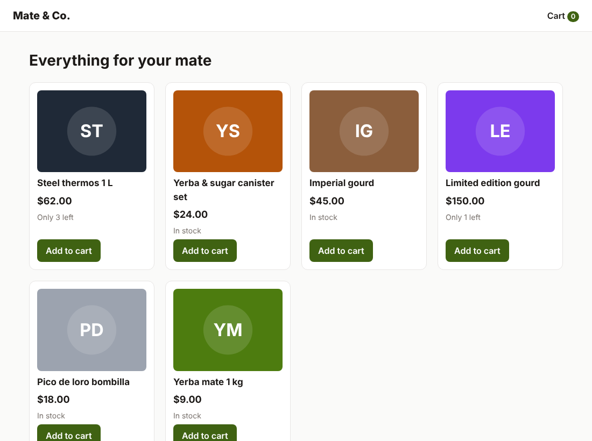
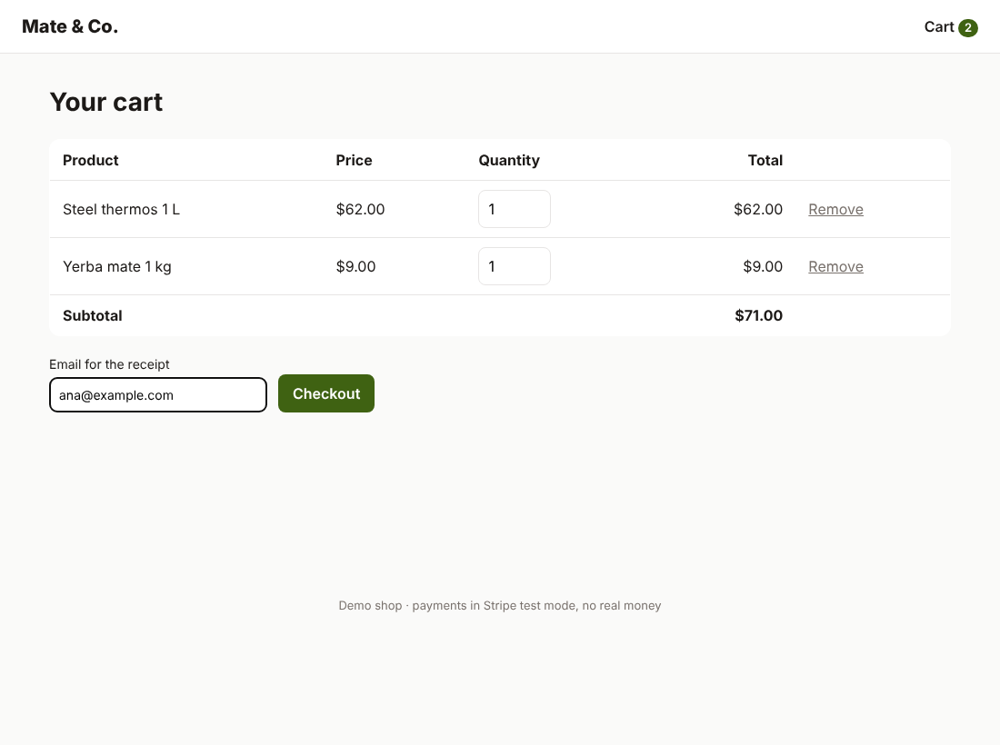
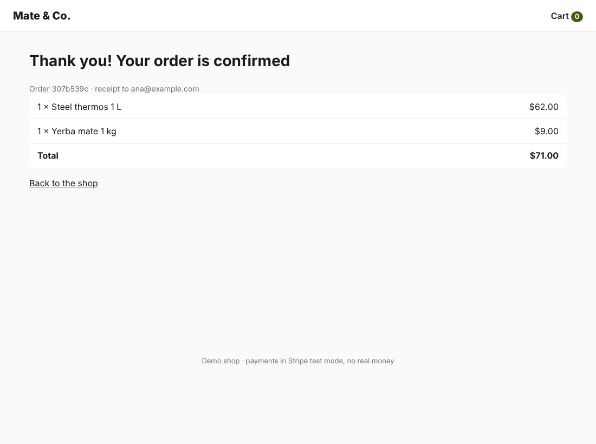
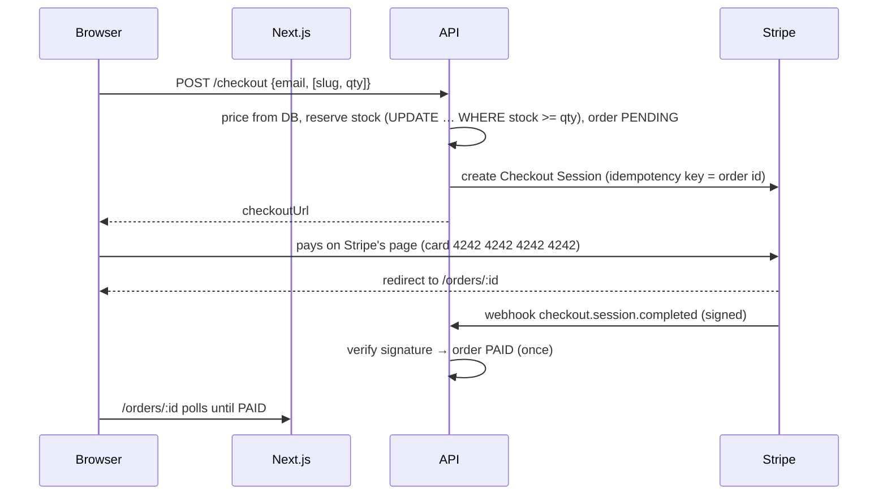

# Mate & Co. — a small e-commerce with Next.js, NestJS and Stripe

A storefront with a cart and **Stripe Checkout in test mode**. The backend is careful where money and stock are involved:

- prices are set on the server;
- stock is reserved atomically;
- webhooks are verified and idempotent;
- reservations nobody pays for expire.



| Cart | Order confirmed |
|---|---|
|  |  |

## Stack

- **web/**: Next.js 16 (App Router). Server components for the catalog; client components for the cart, kept in `localStorage`.
- **api/**: NestJS 12, TypeORM, PostgreSQL (in-memory SQLite when no `DATABASE_URL` is set), and the Stripe SDK.
- **e2e/**: Playwright tests of the whole shop.

## How a purchase works



## Design decisions

- **The client sends only slugs and quantities.** The API reads prices from the database and copies them into the order. A request that includes a price is rejected (400). Old orders keep their prices even if the catalog changes.
- **Money is stored in cents**, as integers.
- **No overselling.** Each line reserves stock with a conditional `UPDATE … SET stock = stock - n WHERE stock >= n`, inside one transaction for the whole cart. Two people racing for the last unit: one gets it, the other gets "just sold out". This is tested with parallel requests, on PostgreSQL too.
- **Reservations expire.** An unpaid order holds its stock for 30 minutes, the same lifetime as the Stripe session. After that, Stripe's `checkout.session.expired` webhook releases the stock. A sweeper job does the same if a webhook is lost.
- **Webhooks:**
  - The signature is checked against the **raw** request body with the Stripe SDK, so unsigned or tampered events get a 400.
  - Handling is idempotent (`UPDATE … WHERE status = 'PENDING'`), so Stripe's retries are harmless.
  - `completed` with `payment_status = unpaid` (delayed payment methods) waits for `async_payment_succeeded`.
- **Stripe down?** The order is cancelled and its stock released at once. The shopper sees a 502 and can retry.
- **Zero-setup demo.** Without Stripe keys the API uses a fake provider: a page of the shop with "Pay now" and "Cancel payment" buttons, driving the same order logic. That is what the E2E tests use.

## Run it

```bash
docker compose up --build         # http://localhost:3000 (shop) · http://localhost:4000/docs (API)
```

Without Docker:

```bash
cd api && npm install && npm run dev                     # :4000, in-memory database
cd web && npm install && npm run dev                     # :3000
```

### With real Stripe (test mode)

1. Copy the test secret key from the [Stripe dashboard](https://dashboard.stripe.com/test/apikeys).
2. Forward webhooks with the [Stripe CLI](https://docs.stripe.com/stripe-cli): `stripe listen --forward-to localhost:4000/webhooks/stripe`. It prints a `whsec_…` secret.
3. Start the API with `STRIPE_SECRET_KEY=sk_test_… STRIPE_WEBHOOK_SECRET=whsec_…`.
4. Pay with card `4242 4242 4242 4242`, any future date and any CVC.

## Tests

| Suite | What it covers |
|---|---|
| `api` (Vitest + Supertest, 19) | catalog; server-side pricing; merged cart lines; validation; 409 without partial reservations; **the last unit sold exactly once under a race**; pay, cancel and expiry release stock; Stripe: session parameters + idempotency key, **signature verification (unsigned, wrong secret, tampered body)**, retried webhooks, delayed payments, expired sessions, Stripe outage |
| `web` (Vitest, 4) | cart reducer: merging lines, stock and per-line limits, removal |
| `e2e` (Playwright, 4) | browse → cart → checkout → pay → confirmation; cancelling returns the stock; someone else buys the last unit first (clear error, cart kept); the cart survives a reload |

The Stripe tests use the real SDK, including its webhook signing. Only the network call that creates a session is stubbed. The API suite runs on the in-memory database and on PostgreSQL in CI.

## Possible next steps

- Customer accounts and order history (the auth from [nest-auth](https://github.com/Nack34/nest-auth)).
- Emailing the receipt, and an admin panel to manage stock.
- Refunds through the Stripe API.

## License

MIT
